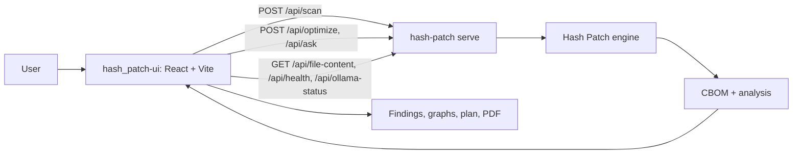

# Hash Patch UI

The web / desktop front end for **[Hash Patch](https://github.com/shriram-s7/hash_patch)**, an offline post-quantum cryptographic discovery and risk-analysis tool. It talks to the Hash Patch engine's local HTTP service and presents scan results as findings tables, graphs, migration plans and PDF reports.

**Links:** [GitHub](https://github.com/shriram-s7/hash_patch-ui) · Engine: [hash_patch](https://github.com/shriram-s7/hash_patch) · [Desktop release v0.1.0](https://github.com/shriram-s7/hash_patch/releases/tag/v0.1.0) · [Demo video](https://youtu.be/5Hb2-dnYOR8)

## Overview

Hash Patch scans a code base for cryptography and produces a CycloneDX 1.6 CBOM. This UI is the "forensic terminal" view of that data: pick a folder, run a scan, then explore which cryptographic assets are reachable, what quantum risk they carry, and what to migrate first. It runs as a normal Vite web app and is also embedded in the Hash Patch Desktop (Electron) build, where the desktop shell supplies the engine URL and a native folder picker.

## Desktop downloads (Windows x64)

- [HashPatch-Setup.exe (installer)](https://github.com/shriram-s7/hash_patch/releases/download/v0.1.0/HashPatch-Setup.exe)
- [HashPatch-Portable.exe (standalone)](https://github.com/shriram-s7/hash_patch/releases/download/v0.1.0/HashPatch-Portable.exe)
- [All releases](https://github.com/shriram-s7/hash_patch/releases/latest)

## Features

- **Home and workspace:** path entry, scan history, guided workflow tour, folder tree and per-file code view (`HomeView`, `EntryScreen`, `FileWorkspace`, `src/tour/`).
- **Findings:** all-findings table and a unique-findings view grouped by primitive, with reachability, exposure and quantum-status badges.
- **Graphs:** blast-radius and call/cluster graphs with search, zoom, minimap and legend (`react-force-graph-2d`).
- **Shelf-life and risk charts:** donut, folder-risk, file-priority and risk-curve charts (`chart.js`), plus a timeline scrubber.
- **Migration planner and optimiser:** budget-driven plan from the engine's `/api/optimize`.
- **Reports:** multi-page A4 PDF export (`jspdf`, `html2canvas-pro`).
- **Ask:** natural-language questions about a scan, answered by the engine (optionally using a local Ollama model).
- **Light/dark theme** and CBOM export.

## How it works



In the browser the service URL defaults to `http://localhost:8000` (`src/serviceUrl.ts`). In the Electron build the shell injects the real URL through `window.hashPatchApi.backendUrl`.

## Tech stack

| Layer | Technology |
|---|---|
| UI | React 19, TypeScript |
| Build | Vite, Tailwind CSS (`@tailwindcss/vite`) |
| Charts and graphs | chart.js / react-chartjs-2, react-force-graph-2d |
| Reports | jsPDF, html2canvas-pro |
| Code display | prism-react-renderer |
| Quality | Vitest, Oxlint |

## Project structure

```text
src/
  *.tsx            views: Home, Entry, FileWorkspace, FindingsTable, BlastRadius, Migration, Report, Ask, Settings
  cbom/            CBOM types and CBOM-to-findings mapping
  charts/          chart components
  components/      graph legend, minimap, search bar, dividers
  badges/          exposure, quantum-status and reachability badges
  plan/            migration plan helpers
  tour/            guided tour (coachmarks, store, hotkey)
public/fixtures/   demo CBOM fixtures
```

## Getting started

Prerequisites: Node.js 20+ and npm, and the engine installed from [hash_patch](https://github.com/shriram-s7/hash_patch) (Python 3.11+).

```powershell
# terminal 1: engine service on the port the UI expects
cd ..\hash_patch
pip install -e ".[dev]"
hash-patch serve --port 8000

# terminal 2: UI
git clone https://github.com/shriram-s7/hash_patch-ui.git
cd hash_patch-ui
npm ci
npm run dev
```

On Linux/macOS the commands are the same with `/` path separators. Open the URL Vite prints. No environment variables are needed. Note the engine's own default port is 8420, so pass `--port 8000` or the UI will not find it.

## Usage

Enter a project path on the home screen and run a scan (the fixtures in `public/fixtures/` provide sample data). Then open the findings, graph, migration and report views.

## Tests

```bash
npm test          # vitest run
npm run lint      # oxlint
npm run build     # tsc -b && vite build
```

Observed while writing this README: **8 tests passed (3 files)**, and `npm run build` completed. Lint was not run.

## Status and limitations

- Works against `hash-patch serve` only; there is no standalone mode without the engine.
- Test coverage is limited to CBOM mapping, relationship findings and the tour clipboard subscriber.
- The production bundle is a single large chunk (Vite warns about chunk size).
- Active development happens on the `ui-rebuild` branch; the GitHub default branch is `master`.

## Credits

Built by S Shriram as part of the Hash Patch project (Smart India Hackathon 2026, problem statement 26164).

## License

No license specified.
